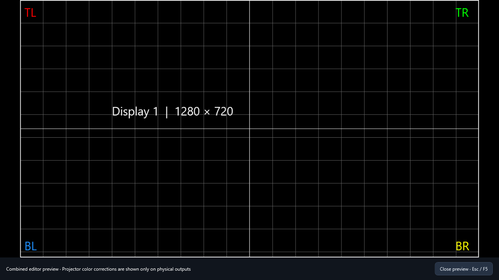
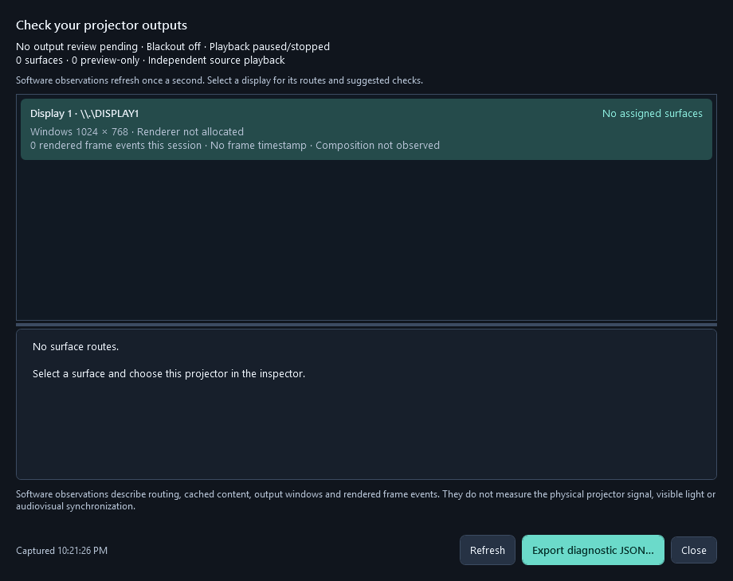

# Milestone 8 — Output verification

## Composed preview

**View > Preview** or **F5** opens a borderless preview on the editor's current display. Press **Esc**, **F5**, or the close button to return to editing. F5 from the editor also closes an existing preview.

The preview observes the composed editor frame, updates during playback, and keeps its aspect ratio. It does not attach another renderer, start another decoder, change assignments, or open a projector output. Closing clears only the preview binding; the editor's current frame remains intact. Blackout continues to work through the existing app input handler.

This is the combined editor composition. Per-projector color correction and blending are applied on physical output renderers, so evaluate those there. The preview is not a measurement of the projector signal.

The preview controls occupy their own strip so they do not obscure the image corners.

## Output status

Open **View > Output status…**. The modeless window is available during Performance mode and refreshes once a second using asynchronous delays. It does not automatically fix routing, reopen output windows, call providers, change display modes, or pause playback.

Each connected display shows:

- Detected Windows pixel dimensions and the actual allocated output-renderer size.
- Whether its output window exists and is visible.
- Composed frame events accumulated for that output index during the app session, last frame-event age, and the latest software composition time.
- Assigned surface/source names, current cue activity, cached-content availability, and opacity.
- Specific findings and suggested checks for a blocked or empty output.

Select a display to see its routes and advice. Assigned outputs that are no longer detected remain listed as unavailable. Preview-only surfaces are counted separately.

Findings distinguish missing displays, pending assignment review, blackout, no assigned surfaces, inactive cues, transparent surfaces, missing cached content, closed windows, uninitialized renderers, renderer/Windows resolution mismatches, and absent/stale frame events. A fresh frame event does not prove that the pixels contain visible content or that the physical projector is receiving them. Masks, mapping, projector input selection, cables and physical alignment still need inspection.

## Export for troubleshooting

Choose **Export diagnostic JSON…** to write a fresh detached snapshot using atomic file replacement. The report contains the project/source names, app/.NET/OS/backend versions, software state, display modes, routing and frame observations. It excludes media-path fields, credentials, photos, prompts, and image bytes. No report is uploaded or sent automatically.

No project format change is required. Diagnostics are observations, not saved editing settings.

## Verification

The cross-platform regression covers finding priorities, inactive vs missing content, opacity, missing outputs, closed windows, resolution mismatches, stale events, preview-only routing, and actual JSON export/round-trip. Windows checks exercise the real frame binding, frame changes, F5 close/cleanup, snapshot capture from the actual empty editor, periodic status refresh, cancellation on close, and non-overlapping preview controls. CI captures both new windows from their real XAML for visual review; the preview screenshot uses a locally generated calibration grid rather than a fabricated provider result.

On installation hardware, verify editor-monitor fullscreen placement at mixed DPI, F5/Esc, pause/resume, blackout, unchanged projector assignments, unavailable-output reporting, and status while operating real cues. GPU acceleration and sustained physical-show acceptance remain separate roadmap work.
