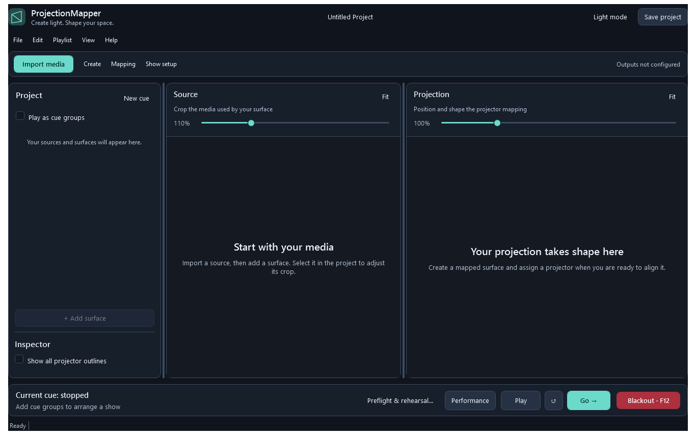

# ProjectionMapper tutorial: from your first surface to a show

Start with one short video, one flat object, and one projector. Get that working before adding AI artwork, multiple surfaces, or a playlist. You can learn the editor without a projector by keeping surfaces on **Preview only**.

This tutorial follows the redesigned desktop UI. A **source** supplies video; a **surface** (also called a mesh) selects part of that source and maps it onto an object; a **cue** is a playlist group containing sources.

## Choose your starting point

- [Install and find your way around](#1-install-and-open-the-app)
- [Create your first projection](#3-import-a-video-and-add-a-surface)
- [Map objects from a photograph](#6-optional-map-objects-from-a-photograph)
- [Generate and save AI artwork](#7-optional-generate-ai-artwork)
- [Build cues and run the show](#9-arrange-a-show-with-cues)
- [Transfer to another computer](#11-save-and-transfer-the-complete-show)
- [Troubleshooting and shortcuts](#12-troubleshooting)

## 1. Install and open the app

1. Open [GitHub Actions](https://github.com/SequentialExecutor/ProjectionMapper/actions/workflows/dotnet-desktop.yml) and select a successful **.NET Desktop CI** run for `master`.
2. Download the **ProjectionMapper-win-x64** artifact. GitHub may require you to sign in to download artifacts.
3. Extract the entire ZIP and launch `ProjectionMapper.exe`. Keep its supporting files and `appsettings.json` together. This Windows build includes its .NET runtime.
4. For video playback, install trusted Windows builds of **ffmpeg.exe** and **ffprobe.exe**. Put both in `Native/ffmpeg/` inside the application folder, or on your Windows PATH. The [installation guide](../ToDo/INSTALLATION.md) explains the configuration alternative.
5. If using a projector, connect it before starting the app. Set Windows display mode to **Extend** so the editor and projected output can occupy separate displays. Keep the projector position and zoom fixed once you align it.

**Checkpoint:** The editor opens. You can start in preview-only mode even if no projector is connected.

## 2. Learn the workspace

*The empty editor, rendered from the application on Windows. Zoom percentages in this screenshot are view settings, not projector resolution.*

| Area | What you do there |
| --- | --- |
| **Import media** | Add a video source. |
| **Create** | Open Photo to map or the AI artwork library. |
| **Mapping** | Calibrate outputs, use camera-assisted calibration, or edit masks and curved meshes. |
| **Show setup** | Assign outputs, adjust projector color/blending, or edit a selected cue. |
| **Project** | Select sources, their surfaces, and cue groups. Right-click an item for its actions. |
| **Inspector** | Change the selected item's projector, opacity, mapping lock, outlines, or audio. |
| **Source** | Choose the portion of media used by the selected surface. |
| **Projection** | Position and reshape that surface's destination mapping. |
| Bottom show strip | Play/pause, restart, advance with Go, enter Performance mode, or blackout. |

Use **Fit** above each preview to bring the full frame into view. The zoom sliders and panel dividers change your view of the editor; they do not change the projector's resolution or the saved mapping coordinates.

Choose **View > Appearance** for Dark, Light, or Follow Windows. The header's Light mode/Dark mode button is a quick switch.

## 3. Import a video and add a surface

1. Click **Import media** and choose a short local video. The picker lists MP4, AVI, MOV, MKV, and WMV; actual decoding depends on your FFmpeg build and the file's codec. Start with an ordinary MP4.
2. Select the imported source in **Project**.
3. Click **+ Add surface**, or right-click the source and choose **Create Mesh Layer**.
4. Expand the source and select its new mesh. Right-click it and choose **Rename Mesh**; use a physical name such as “Front panel.”
5. Click **Fit** in both previews. Use **Play** if playback is paused.
6. In **Source**, adjust the mesh's corner handles to choose the crop. A new mesh starts with a smaller centered region; expand the source selection if you want more of the video.
7. In **Projection**, adjust the destination handles to position and shape the mapped image.

**Checkpoint:** The selected crop appears inside a mapped surface in the Projection preview. Source edits choose content; Projection edits change where that content lands.

To map several objects from one video, select the source and add more surfaces. Each gets its own crop and destination. Right-click the source for **Create Sliced Mesh Layers** when you want horizontal slices as a starting point.

## 4. Assign the projector and align the object

1. Select the mesh. Leave **Lock mapping** off while aligning.
2. Open **Mapping > Manual calibration…**.
3. Choose an output and enable **Show numbered grid**. Identify the physical projector by its displayed number and resolution. The grid temporarily replaces video on that output.
4. Click **Assign mesh to selected display**. Alternatively, use the mesh's **Projector** picker in the main inspector. Use **Preview only** when you do not want a physical output.
5. Disable the grid when judging the content itself. Adjust the destination corners until the image meets the object's edges. The calibration panel lets you select a corner, enter native projector-pixel X/Y values, and **Apply** them. Its arrow buttons provide small nudges; Shift multiplies the chosen nudge step by ten.
6. Close the calibration panel with **Done** to restore normal content. Turn on **Outline on projector** temporarily if it helps you see the mesh boundary.
7. Once satisfied, enable **Lock mapping**, turn off projector outlines, and save with **Ctrl+S**. Choose a working `.pmproj` file.

**Checkpoint:** Light falls on the intended object, the source crop is correct, and the mapping is locked and saved. Check the physical result, not only the editor preview.

### Optional: camera-assisted alignment for a flat surface

Use **Mapping > Camera-assisted calibration…** for alignment using a photograph of known projected markers. This runs locally and needs no AI token.

1. Select an unlocked mesh assigned to a projector. Disable its curved grid for this planar operation.
2. Set a marker region of at least 320×320 native output pixels, entirely on one flat physical plane, and **Generate and project new markers**.
3. Keep the setup fixed, photograph the markers, and **Import marker photograph…**.
4. Inspect the detected marker IDs and centers. Correct matches if necessary. Keep at least five fit markers and two independent check markers with good coverage.
5. Choose **Mark target corners** and click **top left, top right, bottom right, bottom left** in that same photo.
6. Choose **Fit and review errors**. Resolve rejected geometry or excessive fit/check errors before continuing.
7. **Project target outline for verification**, inspect all four physical corners and image orientation, complete the confirmation, then **Apply to selected mesh**. Save the project.

The [camera calibration guide](../ToDo/CAMERA-CALIBRATION.md) covers coverage, error tolerance, and evidence. Moving the projector or changing the scene requires alignment to be checked again.

## 5. Set audio deliberately

Select a source and enable **Play audio from this source** in the inspector if needed. Start with one audio source and check your Windows audio output device. Test pause/resume and cue changes through the speakers you will use at the venue. Visual cue fades do not crossfade audio.

## 6. Optional: map objects from a photograph

Photo to map helps outline objects and create starting meshes. A regular scene photograph does not establish precise projector alignment; use the alignment workflow afterward.

1. Select an imported video source in the main window if you want to create meshes from the photo.
2. Open **Create > Photo to map…**, then **Import scene photo…**. Importing a photo alone does not upload it.
3. For manual outlines, choose **Draw polygon**, click perimeter vertices in order, and choose **Finish polygon**. Drag vertices or edit their percentages to refine the outline.
4. For AI proposals, enter an **OpenAI API key**, describe the objects to find, review and enable the upload/billing notice, then click **Analyze photo and add proposals**. This feature currently uses OpenAI; it has a separate key field from the artwork library.
5. Select each useful outline, correct it, rename it, and mark **Reviewed / accepted**. AI proposals require your review.
6. To create meshes, enable **Create preview-only meshes from accepted convex quads for the selected video source** and acknowledge that manual alignment is required. Only accepted, convex, four-corner outlines become meshes; other polygons remain photo annotations. **Fit bounding quad** adds a rectangular approximation when useful.
7. Click **Save photo maps to project**, then save the main project to disk.
8. Select each created mesh, assign its projector, and align it using section 4.

Editing a photo outline later does not reposition an already calibrated mesh. For more photo editing options, see [Photo to map](../ToDo/PHOTO-TO-MAP.md); follow the menu names in this tutorial for the current UI.

## 7. Optional: generate AI artwork

Map and name your surfaces first. The artwork library uses those surfaces to guide the composition and preserves their calibrated corners.

1. Open **Create > AI artwork library…**. Select one to eight surfaces in **Mapped surfaces**; use Ctrl-click for several. Choose **Refresh surfaces** after changing the main project if needed.
2. Choose **OpenAI**, **Google Gemini**, or **Stability AI**. Enter that provider's **API access token**. Use a provider-issued API key; a chat subscription or browser login token does not provide API access.
3. Optionally enable **Remember in Windows Credential Manager**. Otherwise the key stays in the dialog's session memory. **Forget stored token** removes the selected provider's saved credential. Keys are not saved in the project.
4. Enter a prompt, project style, and palette. For a first attempt, try:

   > Soft flowing botanical shapes, large simple forms, generous dark negative space, no lettering. Keep the composition readable from across a room.

   Set a consistent style such as “minimal botanical illustration” and a palette such as “teal, warm ivory, deep navy.”
5. Choose image size, supported quality/background settings, and **1** variant for your first request. Use an account-accessible compatible model. OpenAI and Gemini support reference images in these adapters; Stability Core uses text guidance. Unsupported settings are limited by the selected provider.
6. Set **Download folder**, or use **Choose folder…**. Review and enable the upload/billing notice, then choose **Generate and download**. Your provider bills your account; cancelling a submitted request may still incur charges.
7. Select a completed variant and choose **Preview on projectors**. Inspect it on the real objects. **Restore preview** returns to the permanent content.
8. Choose **Keep in project library** to retain a candidate, or **Apply to selected surfaces** to assign it. Then save the main project.

**Checkpoint:** A PNG is in your download folder and accepted artwork is embedded in the saved project. Downloading alone does not accept an image into the project library.

Use **Use selected image's settings** to restore a previous generation setup, or **Use selected as reference** to guide a new variation. **Download selected PNG** exports the selected result again.

Accepted artwork can play without an API key or network. An existing video can still supply audio/timing beneath an artwork assignment. If its original video is absent, still fallback requires artwork on every mesh under that source, and cannot reproduce the missing audio. Set **Offline still cue duration (seconds)** for playlist timing. The inspector's **Restore video content** returns a mesh to its video, relinking the original if necessary.

## 8. Optional: masks, curved surfaces, and output color

Select an unlocked mesh and open **Mapping > Masks and curved mesh…**.

- Use **Draw mask**, click the permitted perimeter, and **Finish** to limit visible content. Add inward feathering for a softer edge.
- Initialize a curved-surface grid and drag its nodes to adjust content across a curved object. Start with a coarse grid; folded cells are rejected.
- Choose **Preview on outputs**, inspect the result, then **Apply**. Cancel restores the previous settings.

For output color, use **Show setup > Projector color and blending…**. Select the projector and adjust brightness, gamma, and RGB while watching the physical projection. For overlapping projectors, align the same content first, then adjust opposing blend widths. Save once satisfied. See [artist controls](../ToDo/ARTIST-CONTROLS.md) for the detailed behavior.

## 9. Arrange a show with cues

1. Click **New cue** in the Project panel. Right-click the group to rename it.
2. Right-click an imported source and choose **Add to Group**, then the desired group. Repeat for the sources in that cue. Add another cue for the next part of the show; use a group's **Move Up/Move Down** actions to order it.
3. Enable **Play as cue groups**. With it off, sources use independent looping playback.
4. Select a cue group and open **Show setup > Selected cue settings…**.
5. Choose sequential playback for one source after another, or simultaneous playback for sources that should appear together. Set advancement:

   | Mode | When it advances |
   | --- | --- |
   | **MediaEnd** | After the cue's sources finish. |
   | **Manual** | Holds the final image until you press Go. |
   | **Timed** | After the configured hold, beginning after fade-in. Pause suspends the timer. |

6. Set a visual fade if desired. Each transition fades out to black, switches cues, then fades in; the setting is seconds per leg. Choose **Apply**. Restart the playlist to load edited cue settings.
7. Press **Go →** to start or advance. **Play/Pause** pauses or resumes without advancing; Go while paused resumes and advances. Watch the current/next cue labels. The next image is a content reference, not a separately playing preview.

## 10. Rehearse and operate

1. Open **Preflight & rehearsal…** on the bottom strip and choose **Run preflight**. Resolve errors and review warnings about media, decoder tools, and outputs.
2. Choose **Start rehearsal recording**, operate the actual show, then **Stop / show report**. Add observations and **Export report JSON…** if useful. A report records software observations; it cannot judge physical alignment or audio drift for you.
3. Save, hide projector outlines, and enable **Performance**. It runs fresh checks and locks editing when ready. Keep the main window active for its live keyboard shortcuts.
4. Use Go, Play/Pause, and restart as rehearsed. **Blackout / F12** makes projector output black while playback continues. Press it again to restore the current content; blackout is not pause.
5. If a display is disconnected or the layout changes, review **Show setup > Assign projector outputs…**. Output stays blocked until assignments are reviewed; explicitly restore it afterward and recheck alignment.

Before the event, run the full show on the actual computer, projectors, media, and audio equipment, including offline playback if required.

## 11. Save and transfer the complete show

Normal **Save** preserves your project, embedded accepted artwork, photos, and mapping. It does not copy all original video files beside the project.

1. Save the working project.
2. Open **Preflight & rehearsal… > Collect Project…** and choose a parent folder.
3. Wait for collection to finish. It creates a new verified folder with `show.pmproj`, collected media, and `collection.json`.
4. Copy that entire folder to the destination computer. Install the application and any required FFmpeg tools separately.
5. Open `show.pmproj`, review output assignments, run preflight, and check physical alignment again. AI tokens and the external artwork download folder are unnecessary for accepted-artwork playback.

Treat the collection as a transfer snapshot. To edit an opened collection, save a working copy outside it, then collect again. Keep a backup of the last rehearsed show. See [installation and transfer](../ToDo/INSTALLATION.md) for details.

## 12. Troubleshooting

| Symptom | What to check |
| --- | --- |
| Add surface is disabled | Select an imported video source first. |
| Mesh handles do not move | Exit Performance mode, unlock the mesh, and enable **Show editing handles**. |
| Nothing on the projector | Check blackout, reviewed output assignments, the mesh's Projector setting, active cue, opacity, and source availability. Preview only does not project. |
| Projection has outlines or a grid | Turn off projector outlines or close/disable the calibration pattern. |
| Preview looks cropped or too large | Use **Fit**; then check the source crop separately. Zoom does not resize the physical mapping. |
| Imported video will not play | Run preflight with media inspection; check FFmpeg/ffprobe, the original file, and its codec. |
| No audio | Enable the selected source's audio, verify original media and the Windows playback device, and test outside blackout. Blackout does not mute audio. |
| AI request fails | Check the selected provider, its API key, account/model access, billing, and connection. Review the status before submitting again. |
| Downloaded art disappears after reopening | Accept with **Keep in project library** or **Apply to selected surfaces**, then save the project. |
| Photo-created mesh does not align | Photo outlines are starting geometry. Assign and calibrate the projector. |
| Camera marker imaging will not load | Keep the full application package together; check the Microsoft Visual C++ 2015–2022 x64 redistributable. |

**View > Preview / F5** is currently a placeholder. Use the Projection editor and assigned projector outputs for the working preview workflow.

## Keyboard reference

| Shortcut | Action |
| --- | --- |
| Ctrl+N / Ctrl+O | New project / open project |
| Ctrl+S / Ctrl+Shift+S | Save / Save As |
| Ctrl+Z / Ctrl+Y | Undo / redo in the active editing context |
| Ctrl+C / Ctrl+V | Copy / paste mesh |
| Delete | Delete selected mesh while editing |
| F10 | Toggle Performance mode with the main window active |
| Space | Go in Performance mode, with the main window active |
| F12 | Toggle blackout, including while an app dialog has focus |

Performance mode blocks editing shortcuts. Save and the live show controls remain available.
